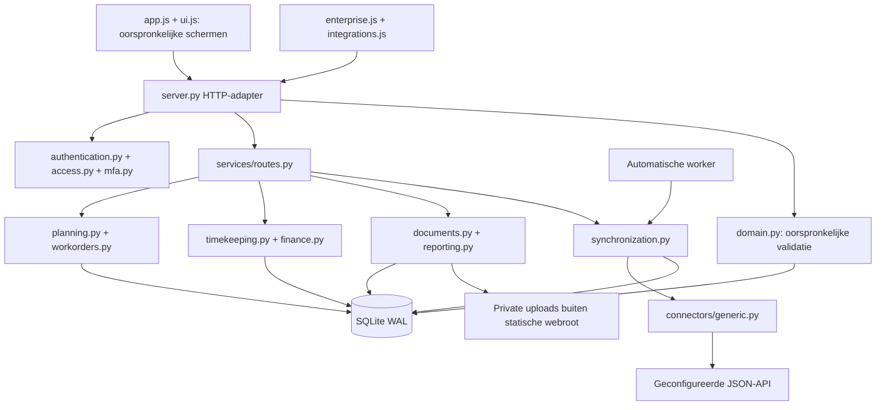

# Architectuur

## Behoud en analyse

De oorspronkelijke Python/SQLite-applicatie is uitgebreid, niet vervangen. Baseline: commit e914d1549ad2102a2e6311bd6ddea036b57179b3; 45 manifestbestanden gecontroleerd. Alle oorspronkelijke 21 modules blijven aanwezig. De vorige controles zijn opnieuw uitgevoerd vóór bronwijzigingen; zie `reports/BASELINE-V5.md`. Een volledige private projectkopie en consistente databasekopie zijn buiten de distributie bewaard.

De oorspronkelijke compacte router en schermen blijven voor compatibiliteit. Nieuwe bedrijfsregels zitten in `services/`; dit is een stapsgewijze modularisering. De frontend blijft gewone JavaScript/CSS zonder bouwframework of verplichte betaalde diensten.

| Onderdeel | Verantwoordelijkheid |
|---|---|
| `server.py` | HTTP, oude routes, opstart, sessies, nieuwe router aanroepen |
| `domain.py` | Basismodulevalidatie, eigenaarschap, referenties, oorspronkelijke planning |
| `services/access.py` | Expliciete rollenmatrix en routeautorisatie |
| `services/authentication.py`, `mfa.py` | Cookie/CSRF, TOTP, verificatie |
| `services/migrations.py`, `sync_migrations.py` | Additieve schemawijzigingen en indexen |
| `services/common.py` | Transactiehelpers, Decimal, audit en interne meldingen |
| `services/planning.py` | Kwalificaties, materieel, reistijd, suggesties, versies en undo |
| `services/workorders.py` | Statusmachine, checklisttoegang, goedkeuring |
| `services/timekeeping.py`, `finance.py` | Tijdsintervallen, beoordeling, factuurregels en credits |
| `services/documents.py`, `reporting.py` | Private bestanden, CSV en PDF |
| `services/synchronization.py` | Automatische pull/push, lease, conflictbeheer, outbox, backoff |
| `services/connectors/generic.py` | Beperkte HTTPS JSON-connector, versies en idempotentiesleutels |
| `nl.js`, `enterprise.js`, `integrations.js` | Nieuwe Nederlandse labels en werk-/integratieruimte |
| `start.py`, `manage.py` | Startcontrole, migratiebackup, volledige backup/herstel |

## Transacties en concurrerende gebruikers

Mutaties lopen onder `BEGIN IMMEDIATE`; validatie en opslag vormen één transactie. Batchplanning en klantimport zijn geheel succesvol of worden geheel teruggedraaid. Nieuwe procesmutaties vereisen de gelezen `version`; 428 bij ontbrekende versie, 409 bij een verouderde versie. SQL-triggers verhogen versies op de oorspronkelijke tabellen, ook bij wijzigingen via oude routes. De oude API ondersteunt `If-Match`, maar blijft compatibel met oudere clients zonder deze header; dit is een expliciete beperking.

Een gekoppelde V5-werkbon, dienst, urenregel of factuur kan niet via gewone legacy-CRUD worden gewijzigd of verwijderd. Workflowhandelingen vormen de toegestane route. Externe wijzigingen in gekoppelde procesgegevens worden vastgehouden als conflict.

Netwerkverzoeken naar externe systemen vinden buiten SQLite-schrijftransacties plaats. Een duurzame lease voorkomt parallelle workers voor dezelfde koppeling. Een outbox bewaart het oorspronkelijke payload en de unieke verzendsleutel vóór netwerkverkeer. Na een storing wordt dezelfde sleutel gebruikt. Er is geen distributed transaction; betrouwbare uitvoering vereist dat de externe API idempotentie en voorwaardelijke updates werkelijk implementeert.

## Bewuste grenzen

Geen overstap naar een ander framework of databasetype. Geen generatief AI-model: planningssuggesties zijn transparante vaste regels met gewichten. Geen fictieve reistijden. Geen externe factuurverzending, betaling of productiepublicatie. Rapportages beschrijven hun berekening. Bestaande CAO-rekenhulpen blijven indicatief en vereisen actuele inhoudelijke controle.
