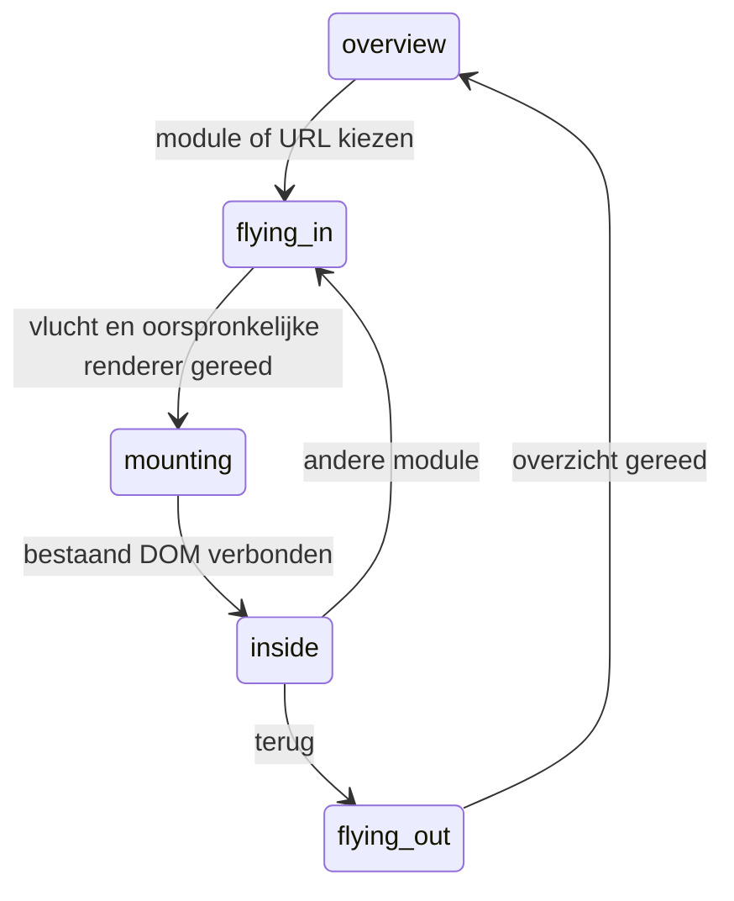

# ROEFS ONE: ruimtelijk portaal, fase 2–4

Open **3D-portaal** op het bestaande startscherm. De dagelijkse startpagina, Python-backend en SQLite-database blijven behouden.

## Fase 2: navigatie en camera

- Iedere bestaande toegankelijke module heeft een eigen ruimtelijk object en een eigen entry-spline. Selectie maakt een CatmullRom-vlucht van circa 1,55 seconden met boog, focusverplaatsing, subtiele lenszoom en een kleine overshoot/settle. Terug trekt de camera uit het werkgebied.
- De bestaande route-identiteiten blijven gelijk. Ruimtelijke links gebruiken bijvoorbeeld `/?ruimte=1#customers`, `/?ruimte=1#shifts` en `/?ruimte=1#invoices`. `?ruimte=1#start` met overview-history-status is het wereld­overzicht. De originele startmodule kan ook als werkruimte worden geopend.
- De sessiecoördinator synchroniseert het bestaande `openPage` met de camera. Browser-terug, vooruit, directe links, cookie-herladen en handmatige fragmentwijzigingen worden ondersteund. Het bestaande menu en de serverrechten bepalen toegang.
- De vroege `spatial/boot.js` legt het oorspronkelijke URL-fragment vast vóór de bestaande boot de starthistorie initialiseert. De bundel staat daarom vóór de bestaande appscripts in `index.html`; de daadwerkelijke uitbreiding initialiseert pas na DOMContentLoaded.
- Snelle opeenvolgende keuzes vervangen de vorige vlucht. Bestaande module-renderers worden in volgorde afgerond; een oude navigatie mag geen nieuwere bestemming overschrijven. Sluiten tijdens een vlucht stopt de wereld en herstelt de bestemming in de gewone interface.

## Fase 3: bestaande werkfuncties in de wereld

- Het originele `#root`-element wordt verplaatst naar een Drei `Html transform`-oppervlak. Er zijn geen gekopieerde klantformulieren of vervangende CRUD-implementaties. Bestaande element-ID's, gedelegeerde acties, validatie, CSRF, cookies, versies en API-aanroepen blijven in gebruik.
- Het HTML-vlak staat in het modulewerkgebied. De grootte is afgeleid van camera-afstand, lenshoek en viewport zodat tekst en bediening leesbaar blijven. Op kleinere schermen schuiven tabellen en lijsten binnen het paneel.
- De toestand `inside` wordt pas gemeld zodra het werkelijke DOM-element aan het verbonden werkpaneel hangt. Een aparte `mounting`-toestand vangt het verschil tussen de React-root van de wereld en die van het HTML-oppervlak op.


- De bestaande werkruimte, planning, klanten, werkbonnen, uren, facturen, instellingen en overige modules blijven beschikbaar. Het beheeraccount in de testfixture heeft 45 moduleobjecten.
- Bestaande modals blijven buiten het canvas werken. Escape sluit eerst een open formulier. Zonder formulier gaat Escape terug naar het overzicht. Focusbeperking en inert-status respecteren de oorspronkelijke dialogs.
- Een beperkte pointer-adapter maakt bestaande draggable elementen bruikbaar in CSS3D en op aanraakschermen. Hij roept de bestaande `data-roefs-dragstart`/`data-roefs-drop`-acties aan. De bestaande planningcode en server voeren de wijziging uit. De gewone bewerkdialoog blijft het toetsenbordalternatief.
- De achtergrond blijft een live scène. Hoog gebruikt werkelijke scherptediepte en een transmissief 3D-frame; de lichtere profielen gebruiken eenvoudiger materiaal en canvasblur. CSS-frosting van DOM-kaarten wordt niet voorgesteld als fysieke refractie van HTML.

## Fase 4: afwerking

- Geluid staat standaard uit. Na een bewuste klik kan Web Audio een zachte whoosh, aankomsttoon en flitsklik genereren. Sluiten stopt de audiocontext. `roefs:world-sound`-events zijn aansluitpunten voor eigen geluidsbestanden.
- Flitsen zijn uitschakelbaar, respecteren reduced motion en zijn begrensd in frequentie. De korte overbelichtingspuls gaat samen met exposure-settle en een kleine lensgloed.
- De hogere kwaliteitsprofielen hebben een bescheiden radiale bewegingsonscherpte tijdens de vlucht. Kaarten en lijsten krijgen korte, gestaffelde beweging uit de diepte.
- Reduced motion schakelt shake, drift, parallax, bewegingsonscherpte, flits en de lange vlucht uit; overgangen duren dan circa 0,12 seconden. Sensorbediening blijft expliciet opt-in.
- De lichte modus bundelt alle modulelichamen en moduleborden in twee instanced draw calls met een textuuratlas, naast de overige scene-elementen. De hoge modus behoudt de uitgebreidere geometrie en materialen. De bestaande Amocean-afbeelding hangt ook als beeldvlak in de wereld.
- De kwaliteitsregeling reageert op korte meetvensters in plaats van lang op 90/180 frames te wachten bij een trage renderer. GSAP-vluchten volgen werkelijke tijd, ook wanneer een shadercompilatie de ticker tijdelijk ophoudt.
- `ROEFSSpatial.metrics()` geeft alleen renderdiagnostiek, zoals draw calls, DPR en kwaliteitsprofiel. Dit bevat geen klantgegevens.
- Bij **Beweging uit** gebruikt het canvas rendering op aanvraag: een stilstaand overzicht of werkpaneel blijft zichtbaar zonder voortdurend nieuwe WebGL-frames te tekenen. Hover, resize, kwaliteitskeuze, navigatie en korte overgangen vragen zelf nieuwe frames aan. De gewone HTML-formulieren blijven los daarvan functioneren. Bij **Beweging aan** blijven camera en achtergrond continu bewegen. Een verborgen tabblad vraagt geen nieuwe frames aan en hervat zodra het zichtbaar wordt.
- Renderdiagnostiek bevat ook `renderedFrames` (cumulatief voor deze wereldsessie) en `renderMode`. Een stilstaande weergave meldt `fps: null`; weinig aangevraagde frames mogen niet worden aangezien voor een trage GPU. De automatische kwaliteitsregeling gebruikt alleen continue meetvensters. Meetresultaten voor deze vervolgstap staan in `reports/world-render-budget-verification.md`.

## Behouden functionaliteit en beveiliging

Python, SQLite-schema, API-contracten, authenticatie-implementatie, bestaande bedrijfsfuncties en serverrechten zijn ongewijzigd. De wijziging zit in presentatiecode, bundel, stijlen en scriptvolgorde. De browsergeschiedenis en DOM-plaatsing worden om de oorspronkelijke route- en schermfuncties heen gecoördineerd.

Bij uitloggen, sessieverlies en sluiten verdwijnen scene, geluid, listeners en drag-overlay. Inlog- en beveiligingsschermen blijven de oorspronkelijke schermen. Deze frontend stelt geen productiegeschiktheid vast.

## Opstarten, bouwen en bewijs

```sh
npm ci --cache /tmp/roefs-npm-cache
node tools/frontend_notices.mjs
npm run build
npm run test:spatial
.venv/bin/python -m unittest discover -s tests -p test_cinematic_integration.py -v
.venv/bin/python start.py --check --quiet
```

Runtime blijft de bestaande Python-server. Docker neemt de gebouwde browserbestanden mee en heeft geen Node-runtime nodig. Het definitieve testverslag staat in `reports/cinematic-verification.md`; de historische fase-1-beelden zijn bevroren in `reports/phase-1/`.

## Grenzen van deze oplevering

De prestaties op fysieke iPhone-, Android- en middelgrote laptop-GPU's zijn nog niet bewezen. Cloudmetingen gebruiken Chromium met software-WebGL; 60/30 fps zijn geen gevalideerde garanties. Safari, duurbelasting en onafhankelijke beveiligingsbeoordeling zijn niet opnieuw uitgevoerd.

Er zijn geen fotografische/video-assets of GLB-modellen aangeleverd. De wereld gebruikt procedurele geometrie, een atlas en de bestaande merkafbeelding. KTX2/Basis- en Draco-bestanden/decoders en een bijbehorende assetbibliotheek zijn niet toegevoegd of als actief voorgesteld. Een echte gecomprimeerde foto/video/GLB-pipeline vraagt passende bronbestanden en afzonderlijke validatie. Dit is een resterend onderdeel van de oorspronkelijke visuele ambitie.
